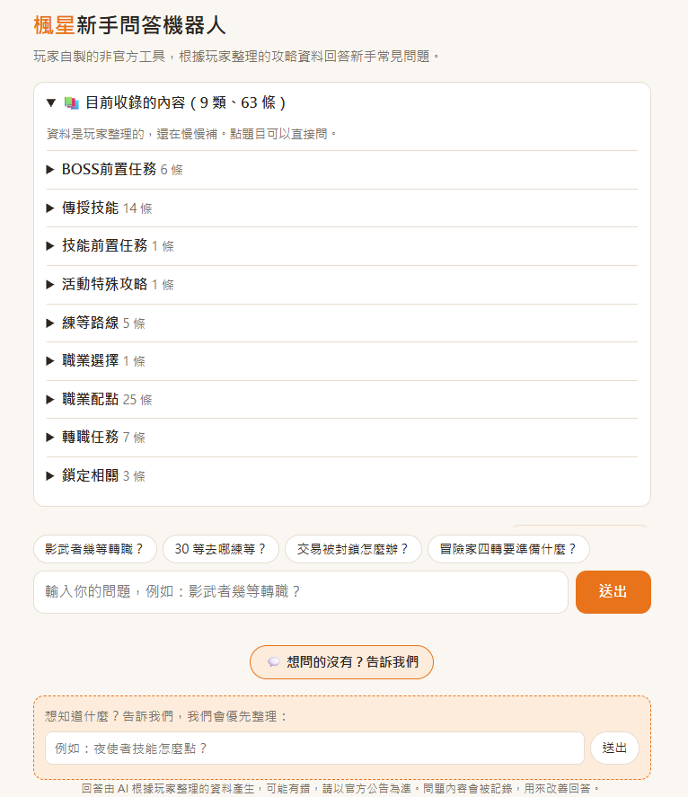

# 楓星新手問答機器人（luren_maplebot）

[](https://github.com/joker9487/luren_maplebot/actions/workflows/test.yml)

給「楓星」社群用的 **RAG 問答網站**。**非官方**，玩家自製。

把 Discord 上散落的攻略整理成知識庫，玩家用自然語言提問，系統先檢索相關段落，再讓 LLM **只根據這些段落**回答，並附上資料來源。
問答與玩家回饋都會記錄下來，用來找出「大家在問、但資料還沒有」的題目，持續補資料。




---

## 功能

- **串流回答**：SSE 一段一段吐字，附資料來源
- **檢索門檻**：與遊戲無關的問題不呼叫模型，直接回固定句（省錢、不亂掰）
- **回饋**：👍 / 👎 + 原因，每題帶隨機 token 防止被灌票
- **目前收錄的內容**：從向量庫自動產生的展開式清單，點題目直接問
- **玩家許願**：問不到時自動邀請玩家留下想問的題目，統計後就是下一批要補的資料
- **相同問題快取**：同問題 + 同資料 72 小時內直接回，資料一改自動失效
- **Discord 草稿工具**：把討論紀錄交給 LLM 整理成知識庫格式的草稿，自動查重、標出玩家名字，人工審核後再收錄

## 技術

| 層 | 用了什麼 |
|---|---|
| 後端 | Python 3.12、FastAPI、httpx（async）、pydantic |
| 檢索 | Chroma（cosine）+ Ollama `bge-m3`（本機 embedding） |
| 回答模型 | OpenAI `gpt-5-nano`／Ollama（`LLM_PROVIDER` 切換） |
| 紀錄 | SQLite（標準函式庫 `sqlite3` + `asyncio.to_thread`） |
| 前端 | 單一 HTML + 原生 JS，手機版、深淺色 |
| 部署 | Docker Compose + Cloudflare Tunnel（不開 port） |
| 測試 | pytest 132 個（外部服務全部用假的）+ GitHub Actions |

## 架構

```
玩家瀏覽器
   │  HTTPS
   ▼
Cloudflare ◄── Tunnel（筆電主動連出去，不用開 port）── cloudflared 容器
                                                          │ http://app:8000
                                                          ▼
                                                    app 容器（FastAPI）
                                                    ├─ 限流：IP 冷卻 / 每小時 / 全站每日（IPv6 以 /64 計）
                                                    ├─ 同時生成上限（Semaphore，排隊逾時 503）
                                                    ├─ 檢索：bge-m3 → Chroma
                                                    ├─ 快取：qa_logs（key 含資料 hash）
                                                    ├─ 回答：OpenAI / Ollama（SSE）
                                                    └─ 紀錄：SQLite
                                                          │ host.docker.internal:11434
                                                          ▼
                                                    Windows 本機 Ollama（bge-m3）
```

**一個問題的流程**：驗證 → 限流 → 排隊拿名額 → 問題轉向量 → 檢索前 4 塊 → 過門檻？
→ 否：回「找不到」／是：查快取 → 命中直接回、沒中就組 prompt 串流給 LLM → 判斷狀態 → 寫紀錄。

## 做法上的重點

- **增量匯入**：每塊資料記 sha256，`ingest.py` 只重算有改的；換 embedding 模型自動整批重建
- **改資料不用重啟**：Chroma 在同一行程會快取索引，另一個行程 ingest 後原本搜不到新資料。
  ingest 結束時更新標記檔，app 讀取前檢查、變了就重連
- **快取 key = 問題正規化 + prompt 版本 + 模型 + 用到的每塊資料 hash**：資料、prompt、模型任何一個改了都自動失效，不用寫清快取的邏輯
- **名額一定歸還**：自訂 `StreamingResponse` 包 `try/finally`，玩家在串流開始前就斷線也不會漏掉名額
- **斷線也記得到**：串流被取消時用 `anyio.CancelScope(shield=True)` 保護寫紀錄
- **限流防繞過**：只信任 Cloudflare 給的 `CF-Connecting-IP`（app 只綁 127.0.0.1）；IPv6 以 /64 計算，換位址也繞不過
- **CSP 用雜湊放行**：首頁的 inline script / style 啟動時算 sha256，不用 `unsafe-inline`
- **核心邏輯是純函式**：切段、限流（時間可注入）、狀態判斷、問題正規化、快取 key、收錄清單排序，都能直接測
- **不存 IP、回答不回灌知識庫、模型不給工具**

## 壓力測試

`scripts/load_test.py`：每個請求帶不同的假 IP，統計成功 / 429 / 503 和首字時間 P50 / P95。

壓測時**要關掉快取**，不然重複的題目都是快取回答，數字不準（結果裡有快取命中會跳警告）：

```powershell
$env:CACHE_ENABLED="false"; $env:DB_PATH="storage/loadtest.db"; $env:DAILY_LIMIT="100000"; uvicorn app:app
python scripts/load_test.py --users 10 --per-user 3
```

下表的 gpt-5-nano 數字是在快取功能加入之前測的，7b 是關掉快取測的，都是真的呼叫模型。

| 回答模型 | 同時生成上限 | 人數 × 題數 | 成功 / 503 | 首字 P50 / P95 |
|---|---|---|---|---|
| OpenAI gpt-5-nano | 10 | 10 × 3 | 30 / 0 | 0.9s / 2.3s |
| OpenAI gpt-5-nano | 10 | 100 × 3 | 258 / 42 | 20.3s / 21.1s |
| OpenAI gpt-5-nano | 30 | 100 × 3 | **300 / 0** | 9.9s / 12.6s |
| Ollama qwen2.5:7b（RTX 4060 Laptop） | 3 | 5 × 2 | 10 / 0 | 10.4s / 14.8s |
| Ollama qwen2.5:7b（RTX 4060 Laptop） | 3 | 20 × 2 | 17 / 23 | 19.0s / 30.8s |

本機 7b 單題約 3 秒，但 8GB 顯卡同時只能算一題，約 3～5 人同時問就開始排隊逾時，所以正式環境用 OpenAI、本機只做 embedding。

## 專案結構

| 檔案 | 用途 |
|---|---|
| `app.py` | 路由、SSE 串流、限流與同時生成上限、快取 |
| `chunking.py` | 解析 `data/*.md`、切段（純函式） |
| `ingest.py` | 增量匯入 Chroma |
| `retrieval.py` | Ollama embedding、Chroma 包裝（含跨行程重連） |
| `llm.py` | 可切換的回答模型（Ollama / OpenAI / Fake） |
| `prompts.py`、`prompts/` | prompt 組裝、「找不到」判斷；prompt 有版本號 |
| `db.py` | 問答紀錄、回饋、許願、問題正規化、欄位遷移 |
| `ratelimit.py` | 限流（純邏輯，時間可注入） |
| `cache.py`、`topics.py`、`security.py` | 快取 key、收錄清單、安全 header |
| `drafting.py` | Discord 討論 → 草稿 |
| `static/index.html` | 前端 |
| `search_cli.py` | 互動式檢索，看分數、定門檻 |
| `scripts/` | `load_test.py` 壓測、`recent.py` 最近問答與 👎、`suggestions.py` 許願統計、`draft_from_discord.py` 草稿工具 |

## 本機開發

需要：Python 3.12、[Ollama](https://ollama.com)。

```powershell
ollama pull bge-m3
python -m venv .venv
.venv\Scripts\Activate.ps1
pip install -r requirements-dev.txt
copy .env.example .env
python ingest.py --data-dir data/examples   # 用範例資料試
uvicorn app:app --reload                    # http://localhost:8000
pytest                                      # 不需要 Ollama / OpenAI
```


## 部署（Docker + Cloudflare Tunnel）

```powershell
docker compose build
docker compose run --rm app python ingest.py   # 匯入知識庫（之後改資料重跑就好，app 不用重啟）
docker compose up -d app                       # http://localhost:8000（只開給本機）
```

**臨時網址**（不用網域）：`docker compose --profile quick up -d`，`docker compose logs quick-tunnel` 找 `trycloudflare.com` 網址。

**正式網域**：
1. Cloudflare → Zero Trust → Networks → Tunnels 建立 tunnel（Cloudflared、Docker）
2. 新增路由：服務 URL 填 `http://app:8000`（用 `http`、用服務名稱 `app`）
3. token 填進 `.env` 的 `TUNNEL_TOKEN`，`docker compose --profile tunnel up -d`

| 什麼時候 | 指令 |
|---|---|
| 改了 `data/*.md` | `docker compose run --rm app python ingest.py` |
| 改了 `.env` | `docker compose restart app` |
| 程式更新 | `docker compose build`，再 `docker compose up -d app` |
| 看最近的問答、👎、今天統計 | `docker compose exec app python scripts/recent.py`（唯讀；`--down` 只看 👎、`--answers` 印回答） |
| 看許願和問不到的題目 | `docker compose run --rm app python scripts/suggestions.py` |

設定的完整說明在 [`.env.example`](.env.example)。

## 知識庫格式

一個類別一個 md（檔名 = 類別），每個 `##` 是一條；標題下的 `關鍵字：`、`來源：` 是選填欄位（不給模型看），其餘是內容。

```markdown
## 東西被鎖住不能交易怎麼辦
關鍵字：誤鎖、鎖住、不能交易、不能丟、物品鎖
來源：Discord 回報區置頂 2026/10
1. 先截圖物品和角色名稱
2. 到 Discord 回報區開單
```
- 一條超過 800 字會照 `###` 小標切開，每塊開頭補「標題 > 小標」
- 第一個 `##` 之前的文字是類別簡介（顯示在收錄清單，不進檢索）
- 真資料不放在這個 repo，`data/examples/` 是格式範例


